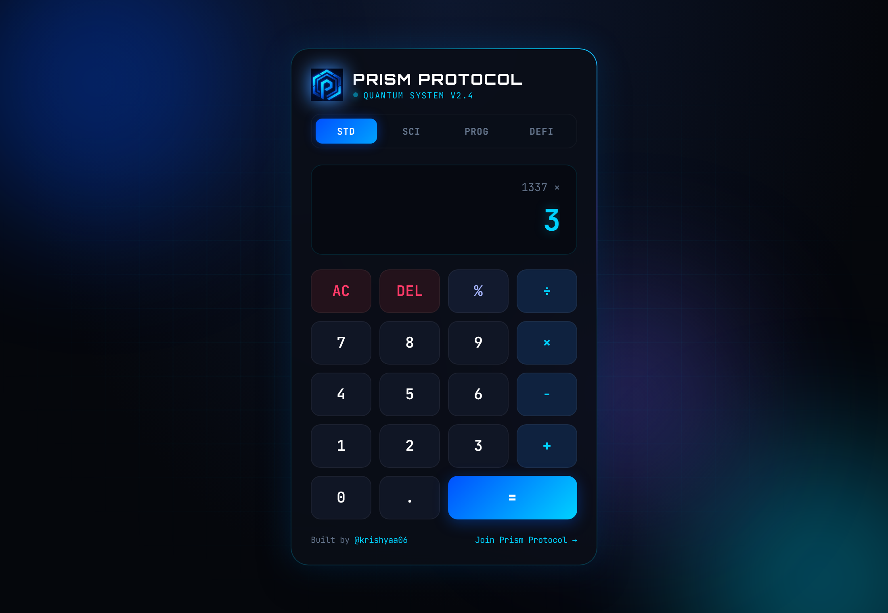
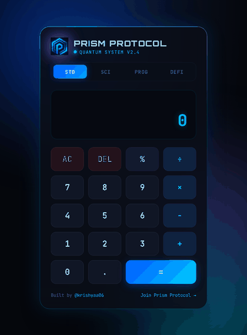
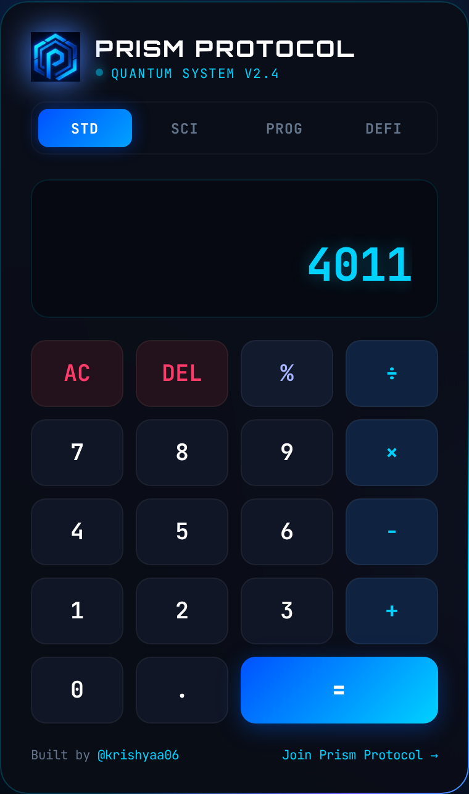
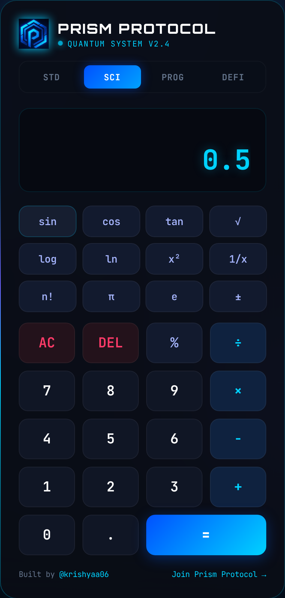
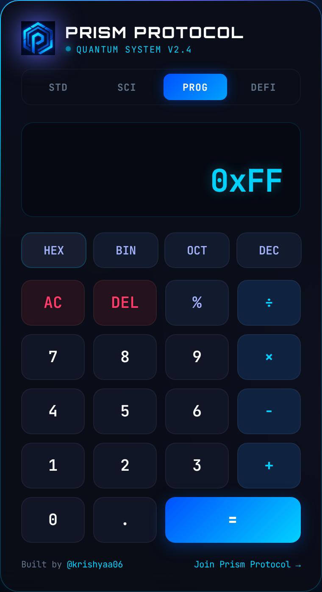
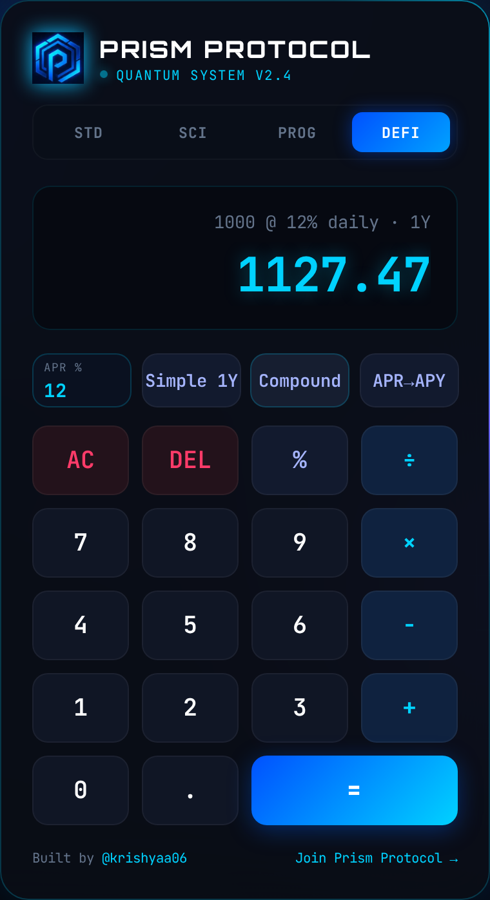
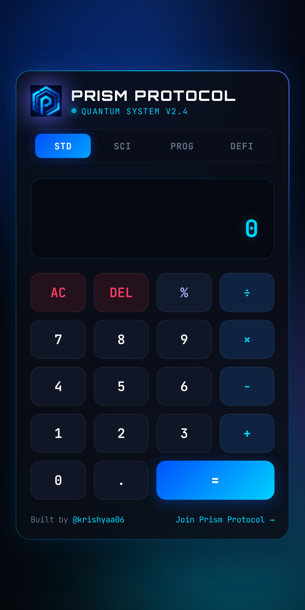

<!-- ═════════════ HEADER ═════════════ -->
<p align="center">
  
</p>

<p align="center">
  
</p>

<p align="center">
  
</p>

<p align="center">
  <a href="https://krishyaa06.github.io/prism-protocol-calculator/"></a>
  
  
  
  <a href="LICENSE"></a>
  
</p>

<p align="center">
  <a href="https://krishyaa06.github.io/prism-protocol-calculator/"></a>
</p>


## ⚡ Overview

**Quantum Terminal** is a sleek, cyberpunk-themed web calculator built for the **Prism Protocol** community.
It combines four calculation modes in a single glassmorphism interface with neon glow, smooth animations and full keyboard support. No frameworks, no build step: just open `index.html`.

## 🎬 Demo

<p align="center">
  
</p>

## 🧩 Modes

<table>
  <tr>
    <td align="center" width="25%"><br><b>STD</b><br><sub>Everyday arithmetic</sub></td>
    <td align="center" width="25%"><br><b>SCI</b><br><sub>Trig, logs, powers</sub></td>
    <td align="center" width="25%"><br><b>PROG</b><br><sub>Base conversions</sub></td>
    <td align="center" width="25%"><br><b>DEFI</b><br><sub>Yield maths</sub></td>
  </tr>
</table>

| Mode | Functions |
|------|-----------|
| **STD** | `+` `−` `×` `÷` `%`, operator chaining, delete and clear |
| **SCI** | `sin` `cos` `tan` (degrees), `√`, `log`, `ln`, `x²`, `1/x`, `n!`, `π`, `e`, `±` |
| **PROG** | Convert integers between **HEX** (`0x`), **BIN** (`0b`), **OCT** (`0o`) and **DEC**; converted values can be used in further calculations |
| **DEFI** | Custom **APR %** input · **Simple 1Y** return · **Compound** (daily, 1 year) · **APR → APY** conversion |

## ✨ Features

- 🌌 **Animated UI**: floating gradient orbs, drifting grid, rotating neon border, ripple on every button press and a result flash
- ⌨️ **Full keyboard support**: digits, `+ - * /`, `Enter` / `=`, `Backspace`, `Esc`, `%`
- 🛡️ **Safe evaluation**: expressions are validated before they are computed; division by zero, `√` of negatives and undefined `tan` show `Error` instead of `NaN` / `Infinity`
- 🎯 **Precise output**: floating-point noise is trimmed (`0.1 + 0.2 = 0.3`) and long numbers auto-shrink to fit
- 📱 **Responsive**: looks great from 320px phones to desktops
- ♿ **Accessible**: live-region display and `prefers-reduced-motion` support
- 🪶 **Lightweight**: zero dependencies, about 25 KB total

## 📱 Mobile

<p align="center">
  
</p>

## 🚀 Getting Started

```bash
# 1. Clone
git clone https://github.com/krishyaa06/prism-protocol-calculator.git
cd prism-protocol-calculator

# 2. Run (any static server works, or just open index.html)
python -m http.server 8080
# → http://localhost:8080
```

## ⌨️ Keyboard Shortcuts

| Key | Action |
|-----|--------|
| `0`–`9`, `.` | Enter number |
| `+` `-` `*` `/` | Operators |
| `Enter` or `=` | Calculate |
| `Backspace` | Delete last digit |
| `Esc` or `Delete` | Clear all |
| `%` | Percent |

## 📁 Project Structure

```text
prism-protocol-calculator/
├── index.html              # Markup and layout
├── css/
│   └── style.css           # Cyberpunk theme and animations
├── js/
│   └── app.js              # Calculator engine (state, modes, keyboard)
├── assets/
│   ├── logo.png            # Prism Protocol logo
│   └── screenshots/        # README images and demo GIF
├── LICENSE
└── README.md
```

## 🗺️ Roadmap

- [x] Four calculation modes
- [x] Keyboard support
- [x] Animated cyberpunk UI
- [ ] Calculation history panel
- [ ] Bitwise operators (AND, OR, XOR) in PROG mode
- [ ] Custom compounding period and duration in DEFI mode
- [ ] Installable PWA (offline support)

## 🤝 Contributing

Contributions are welcome.

1. Fork the repo
2. Create a branch: `git checkout -b feature/amazing-idea`
3. Commit: `git commit -m "Add amazing idea"`
4. Push and open a Pull Request

## 👤 Author

<table>
  <tr>
    <td align="center">
      <a href="https://github.com/krishyaa06"><br><b>Soumya Bhandare</b></a><br>
      <sub>Founder @ Prism Protocol</sub>
    </td>
    <td>
      <a href="https://dc.gg/prismprotocol"></a><br>
      <a href="https://instagram.com/prism_protocol_"></a><br>
      <a href="https://x.com/krishyaa06"></a>
    </td>
  </tr>
</table>

## 📄 License

Released under the [MIT License](LICENSE).

<p align="center">
  <b>If you like this project, consider giving it a ⭐</b><br>
  <sub>"Build. Create. Compete." · Made with ⚡ by Prism Protocol</sub>
</p>


